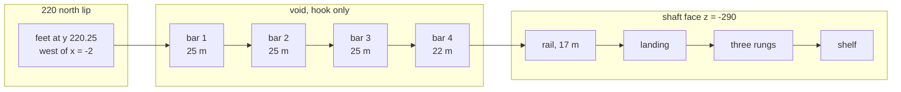

# The second shaft — first crossing

**Status:** built on `feature/second-tower-crossing`. Not played. Not a return route.
**Off:** the 220 ring's north band, west of the middle. **Onto:** a landing bolted to the shaft's near face, then three rungs and a shelf.
**Not this slice:** a way back up, a climb of the shaft, an interior, a second machine tower.

The shaft was already a solid box, centre (−30, 800, −330), half (46, 800, 40), so the face toward the stack is z = −290 and the box runs from grade to 1600 m. The clear gap from the stack's outer north face (z = −176 at the 154 m deck; the 220 ring's own north lip is inboard of that, at z = −173.27) to that face is about 114 m. The hook line is 30 m (`kHookLineMaxM`). Nothing in this slice pretends otherwise.

## Where you leave

The hook rack and the practice member are on the **yard** side of the 220 ring (rack base z = −127.6). The shaft is the other way. Crew already walk the north band at y = 220.25, z = −171, looking at it.

That band is the tapered continuation, level 20 (even, above the stack's 14):

- shrink = 1 − (6 / 24) × 0.42 = 0.895, half-width = 23.27 m
- north slab centre z = −171.27, thickness 0.5, depth 4, so the slab is y 219.75–220.25 and z −173.27 to −169.27
- deck top, where the feet are, y = 220.25

A standing capsule is 1.8 m (`kPlayerHalfHeight` 0.9). The hook measures from the chest, the capsule centre plus 0.3 m, so a person planted on that deck has a chest at about y = 221.45.

From the outer lip (z ≈ −172.9) the first bar is inside 30 m from the west end through about x = −2. At x = 0 it is 30.9 m and the line will not reach. The yellow mark is on the west lip, around x = −17, because that is where the shot exists. East of the mark, the architecture is the refusal. There is no flag and no disabled ability.

| Chest on the lip | First bar | Straight line |
|---|---|---|
| (−22, 221.45, −172.9) | (−18, 222, −198) | 25.4 m |
| (−16, 221.45, −172.9) | same | 25.2 m |
| (−10, 221.45, −172.9) | same | 26.4 m |
| (0, 221.45, −172.9) | same | 30.9 m, out |

## The chain

Four bars, then a rail on the landing's south lip, then a ladder that is already a hold. Each hop below is centre to centre. Reeled in, the chest hangs about a metre under the bite (`kHookLineShortestM` is 1 m); those lines are a few tenths longer and still under 30.

| From | To | Metres |
|---|---|---|
| lip, west | bar 1 (−18, 222.0, −198) | 25.2 |
| bar 1 | bar 2 (−25, 219.6, −222) | 25.1 |
| bar 2 | bar 3 (−32, 217.2, −246) | 25.1 |
| bar 3 | bar 4 (−36, 215.0, −268) | 22.5 |
| bar 4 | rail (−36, 213.85, −284.78) | 16.8 |

The hook is a 1.5 kg body fired at 40 m/s. A 25 m shot takes about 0.6 s and the hook drops about 2 m in that time if you aim flat. The bars step down 2.4, 2.4, then 2.2 m, so the drop has somewhere to land. That is a reason the steps go down. It is not a simulated bite. The playtest is what proves the tines close.

You cannot fire a second hook while the line is still bitten. Release stows it, and the next fire is a new shot. A miss with no bite inside 2.5 s reels the hook back in. Let go over the void and you are falling; the parachute is the recovery that already exists. The previous bar is a recovery only if you are still close enough to bite it again before the drop takes you out of 30 m. This slice does not add a net.

## What is a hold, and what is not

`box_is_hold`: the long full length at least 0.25 m, the other two full widths at most 0.18 m. `add_box` builds a `BoxShape` with Jolt's default convex radius 0.05 m, so a thin half has to stay above that. These holds are half 0.08 on the two thin axes (full section 0.16).

| Part | Full size (m) | Hold? |
|---|---|---|
| CrossingBar ×4 | 4.00 × 0.16 × 0.16 | yes |
| CrossingRail | 2.40 × 0.16 × 0.16 | yes |
| CrossingStile ×2 | 0.16 × 6.10 × 0.16 | yes |
| CrossingRung ×3 | 2.90 × 0.16 × 0.16 | yes |
| CrossingLedge | 3.20 × 0.30 × 1.70 | no — 1.70 m across |
| CrossingBracket | 0.60 × 0.56 × 4.00 | no — both short sides over 0.18, and it does not reach the ground |
| CrossingShelf | 3.10 × 0.24 × 0.80 | no |

The bracket is the only thing tying the landing to the shaft. It is fat on purpose. From the yard, or from the 154 m deck's north lip, the nearest hold is still past 70 m. The 30 m line cannot cheat the gap.

## Where the landing sits

x = −36 is the gap in the face dressing.

- Piers, x centres −68, −49, −30, −11, 8, each 6 m wide. −49 ends at −46, −30 starts at −33. The landing (x −37.6 to −34.4) sits between them.
- Ducts, x centres −60, −40, −20, 0, each 3 m wide. The duct at −40 ends at −38.5. The landing starts at −37.6.

The bracket runs z −290.3 to −286.3, so 0.3 m of it is inside the mass (the mass ends at z = −290) and 0.35 m of it is inside the ledge. Its top is 213.68. The ledge top is 213.85, so the bracket does not come through the floor you stand on. The ledge itself does not enter the mass.

The rail's north edge is 0.09 m south of the ledge's south face, over the void, top 8 cm above the deck. It is a lip grab, not a toe rail. The floating audit grows a part by 0.15 m, so that 0.09 m gap still counts as mounted. That is the one place the chain is a gap rather than a real overlap. If the audit's gap ever tightens under 0.09 m, seat the rail against the slab.

The ladder stands in the ledge: stile bottoms at y = 213.60, the slab is 213.55–213.85. Rungs run through the stile centres (half-length 1.45 m). The shelf sits on the stile tops. Shelf top is 219.67, under the face band at 216 and clear of the next one at 232.

## What the audit is holding onto

World solids hold themselves only if they touch the ground. `TowerMass` does, and the stack's columns carry the 220 north `UpperDeck`. From there:

1. Each `CrossingStay` starts inside that deck (y at the slab centre, z 0.85 m in from the north face, x no closer than 1.1 m to the tapered edge) and ends at a bar centre.
2. The bars are then held, and each `CrossingCable` joins one bar to the next.
3. The bracket overlaps the mass. The ledge overlaps the bracket. The stiles overlap the ledge. The rungs overlap the stiles. The shelf overlaps the stiles. The rail is the 0.09 m case above.
4. `CrossingMark` is paint set into the deck top at the departure.

Stays, cable and mark are `NON_SOLID`. Every other `Crossing*` name is `MIRROR`. Nothing here is exported into `world_solids.inc`. The native bodies are created in `build_second_crossing`, immediately after the shaft mass and before `build_world_solids`, so a later export of the same bounds is skipped as a mirror (`kWorldSolidMirrorTolerance` 0.02 m). They are pushed onto `machine_bodies_`, which the destructor already clears. Entity id is `kCrossingEntityId` (57), not the tower and not a world-solid, so standing on the landing is not reported as standing on the stack. `support_rank` treats any static entity other than the player as ground, and a static support's velocity lookup already returns zero when `body_id_for_entity` has no single body for that id. Thirteen bodies share 57. That is fine while none of them move.

## What you can do there, and what you cannot

You can stand on the ledge (3.2 m by 1.7 m) and climb the rungs to the shelf. The shelf is about 5.8 m above the ledge. That is the ascent this slice has. There is no hop back to the stack and no route further up the shaft. Both are the next slice, and they should wait until someone has actually bitten these four bars. A return drawn now would be another set of unplayed numbers.

## The decisive test

Spawn on the 220 north lip, west of x = −2, with the hook already taken.

1. The first bite lands on bar 1, and the line that pays out is under 30 m.
2. Reel in, release, bite bar 2. Same for 3 and 4. A miss returns the hook; it does not leave you clipped to the air.
3. Bite the rail, get onto the ledge, stand, climb a rung, stand on the shelf.
4. The capsule never passes into `TowerMass`. The bracket is not a grip from the ground.
5. Touch aim on a Fold viewport can put the sight on bar 1 from that lip.

Until that has been done, the straight-line table above is the evidence, and the swing is not.

