# Environment fidelity plan

Written 2026-11-02, 12:25 PM Central, on trunk `f2a21816`. A plan, not an implementation: nothing
here is built.

**The owner's words (2026-11-02, 12:00 PM Central):** *"The 'environment' is lacking, including
weather like slight haze yada yada. It's missing some things that I can't quite put my finger on
it, so I think I will need your help, as you're very good at this. Not only is it lacking things
that signal a 'realistic looking environment', there are graphical improvements and advancements
and upgrades that could be had that would greatly improve the quality and fidelity and depth of
detail. Remember, we want breadth-through-depth."*

**Read as:** two asks. First, name what makes the world read as not real (haze is one; find the
rest). Second, the graphics upgrades that add the most fidelity and depth of detail. Breadth
through depth: the whole world, yard to summit and out to the horizon, each part done properly.

**How this was judged.** The game was run through the Godot MCP runtime (rule 28) in a worktree of
trunk, at the HIGH preset (his phone's default: render scale 1.0, HIGH shadows, 2x MSAA, bloom on),
the hour held at 10:30 unless named. The player was placed with the native's own debug hook
(`debug_launch_player`, as the look tests use it), and a second camera was used for views the
eye cannot hold. Every picture below came from that run, or from CI's own capture command. The
machine renders on llvmpipe (software OpenGL). Colors, values and shapes are the game's; frame
times are not. **Nothing here measures the Fold.** Only his playtests do.

## 1. What he is probably sensing

- **There is no air.** A peak 2 km away is as dark and sharp as the tower 100 m away. So the eye
  reads the mountains as a painted wall close by. The fog is there, but it is lit about as dark as
  the rock. It grays the slopes instead of lightening them, as real haze does.
- **From any height, the world is a model on a table.** It is a flat pale plate, ringed by
  look-alike cones that all carry the same green band. The trees are stacked cones and the clouds
  are cotton balls. Past 2.4 km there is nothing.
- **Steel does not shine, and the colors are too clean.** Reflections are switched off, so metal
  shows no sky. It is either black or flat paint. The yellows are pastel, the containers candy,
  the rust salmon, and every surface has the same single grain.
- **Everything is a perfect box with nothing where things meet.** There are no bolts, plates,
  welds or worn edges. No dirt sits where a post meets a deck. No verge marks where the yard ends.
  The puddles are gray slabs.
- **Nothing moves with the air, and the light is flat.** The wind pushes him and he hears it. But
  no dust, cloth, tree, mist or cloud shadow moves. The day starts under a high sun (52°). The
  DUSK setting is already full night.

## 2. The renderer: stay on Compatibility now

**Decision.** Keep `gl_compatibility` on the Fold. Every gap in section 1 can be fixed in it, and
it has SSAO, which Mobile drops. Move to Mobile only when a job truly needs decals or 10-bit
color. Then do an A/B on his Fold first, after the baked contact shading (job 8) is in.

This goes against the TDD, which names the Mobile renderer (Vulkan) as primary
(`02_ENGINEERING_AUTHORITY/01_TECHNICAL_ARCHITECTURE_TDD.md` §0, §1.1, §18). That text and the
project have disagreed since the first commit. The TDD should be brought into line with a dated
note on why. The integrator decides how; this commit does not touch it.

### Why the project is on Compatibility

- It was set in the project's very first commit, WO-000 (`b7a8ef3a`, 2026-09-16). Both
  `rendering_method` and `rendering_method.mobile` were `gl_compatibility` from that day. No reason
  was written in the commit, the ticket or the archive.
- The reason is visible in the same commit's workflow. It installed only Mesa's OpenGL (`libgl1`),
  with no Vulkan driver. It ran Godot under Xvfb with `--rendering-method gl_compatibility`. Every
  work order since used that recipe (WO-003, WO-004, WO-007, WO-009 result records). So CI could
  render on a runner with no GPU.
- CI still forces it on every Godot step: `.github/workflows/wo000-delivery-spine.yml` lines 600,
  623 and 645 pass `--rendering-method gl_compatibility` on the command line.

### What each renderer has in Godot 4.7

Source: the godot-docs "Overview of renderers" feature tables, and the `Environment` member notes,
checked through the docs tools. "Seen here" means it was rendered and checked in this run.

| Feature | Compatibility | Mobile |
|---|---|---|
| Depth and height fog, aerial perspective | yes | yes |
| Volumetric fog, FogVolume | no | no (Forward+ only) |
| Sky shader, sky ambient, sky reflections | yes (reflections seen here) | yes |
| SSAO | **yes** (seen here: off vs on darkens post feet and ledge undersides) | **no** (the engine warns at start under Mobile) |
| SSIL, SSR, SDFGI, VoxelGI | no | no |
| ReflectionProbe | yes, 2 per mesh | yes, 8 per mesh |
| LightmapGI | renders baked maps; baking needs Vulkan | yes. Not a fit either way: the world is built in code at start-up |
| Glow | yes, a simpler version: `glow_levels/*`, strength, blend mode, mix and map are ignored | yes, lower range than desktop |
| Tonemap (incl. AgX), adjustments, color-correction LUT | yes (AgX seen here) | yes |
| MSAA 3D | yes | yes |
| FXAA, SMAA, roughness limiter | no | yes |
| TAA, FSR2 | no | no |
| Debanding; color precision | no; RGBA8 (8-bit) | yes; RGB10A2 |
| Depth buffer | 24-bit, no reverse-Z | 24-bit, reverse-Z |
| Decals | no | yes |
| Light projector textures; PCSS on omni and spot lights | no | yes |
| Particles | CPUParticles3D (what the game uses); no GPU trails or SDF collision | all |
| Depth of field | no | yes |
| Full-screen post quad | yes | yes |
| CompositorEffects, compute shaders | no | yes |

### What Mobile would unlock, and what it costs

**It unlocks:**
- decals, for grime, rust bleed and oil without UV work;
- debanding and 10-bit color, for smooth haze and sky on his AMOLED;
- FXAA or SMAA, for thin rails and wires;
- reverse-Z depth, so far geometry can sit farther out;
- lamp projector patterns and more reflection probes per mesh.

**It costs:**
- **SSAO**, which works now. The baked contact shading in job 8 would have to replace it first.
- **A full retune of the look.** CI's own capture from the same frame looks different under each
  renderer (picture 13). Under Mobile the mountains wash to near white, the oil stains vanish and
  the contact shading is gone. Every look judged so far was judged in Compatibility.
- **The look check in sessions.** The Godot MCP runtime runs the desktop renderer. To see Mobile,
  a session must install `mesa-vulkan-drivers` and use the capture path with
  `--rendering-method mobile`. A fresh container does not have that driver. Without it, Godot
  silently falls back to OpenGL and shows the Compatibility look, so an agent could believe it was
  seeing Mobile when it was not.
- **Frame time on the Fold: unknown.** The docs give Mobile a higher base cost and a lower scaling
  cost than Compatibility. Only his playtest can say which wins on this scene.

**Keeping CI's proofs if it ever moves:**
- Change only `rendering_method.mobile`. CI passes `--rendering-method gl_compatibility` on the
  command line, so every existing proof keeps running exactly as now. Only Android changes.
- Add one capture under Mobile. It was tried here. With `mesa-vulkan-drivers` installed (after an
  `apt-get update`), CI's own Fold proof command ran under Mobile on lavapipe ("Vulkan 1.4.318 -
  Forward Mobile - Using Device #0: llvmpipe"). It loaded the native extension, printed
  `SCRAPERX_WO004_VIEWPORT_PROOF ... width=2160 height=1856 aspect=1.164 ... stretch=expand` and
  `SCRAPERX_WO005_APPROACH_PROOF ... tower_height=1600`, saved its capture and exited 0. The only
  warnings were RGB8 textures converted to RGBA8 (the corrugation map, `main_geometry.gd:45`).
  It took about 5 minutes against about 2 for Compatibility, partly sharing the CPU.
- The Android build is unchanged: the same arm64 library.

**UNVERIFIED here:**
- his Fold's GPU: public specifications say Adreno 750 with Vulkan 1.3, not checked on his device;
- the Mobile renderer in the Godot 4.7 Android editor on his phone;
- frame time and heat under either renderer;
- the Mobile capture's time on GitHub's runner;
- how much of the haze what-if (picture 9) is aerial perspective alone. Fog energy and density
  changed in the same step.

## 3. Jobs, ranked

The jobs are ranked by visible gain for the cost. Each one fixes a gap from section 1 at its root.

### Lanes: who owns which files

Two agents never share a lane at once. A lane's jobs run in the order given. Where a lane edits a
file another lane also touches, it owns only the functions named.

| Lane | Owns | Jobs, in order |
|---|---|---|
| A, air and light | `sky_cycle.gd` (all but line 65), `sky.gdshader` (all but the cloud-deck block), `main.tscn` (Environment and the two lights), `settings_store.gd` (`TIME_OF_DAY_HOURS` only), `main_world.gd` `_build_lighting` | 1, 3, 12 |
| B, structure surfaces | `main_geometry.gd` `_material`, the bump and weathering textures, `Batcher`; the palette block of `main_world.gd` `_build_world`; `stock_view.gd` palette; `sky_cycle.gd` line 65 (reflections); new `presentation/textures/`; `ui/licences.gd` | 2, 6, 8 |
| C, ground and far world | `mountain_mesh.gd`, `yard_ground.gd`; `main_world.gd` `_build_mountains_and_waterfall`, `_build_basin`, `_build_yard`, `_build_waterfall`; new `far_world.gd`, new `sky_horizon.gdshaderinc` (one `#include` line in `sky.gdshader`, agreed with A) | 4, 11 |
| D, sky life | `cloud_layer.gd`; the cloud-deck block of `sky.gdshader` (after job 3 lands); `life/works.gd`; new `wind_view.gd`, `dust_view.gd` | 5, 10, 13 |
| E, plants | new `foliage.gd`; the bodies of `_add_tree` and `_add_bush` in `main_geometry.gd` (moved to `foliage.gd` in a first commit that lands alone, before lane B starts); `main_world.gd` `_build_foliage`, `_build_foothill_forest` | 9 |
| F, built detail | new `detail_kit.gd`; one call in `main.gd` after `_batch_static_dressing`; `main_world.gd` `_build_tower_skin` | 7, 14 |

All paths are under `godot/presentation/` but `godot/main.tscn`.

### What every job shares

- **Laws.**
  - Presentation only: nothing feeds the native.
  - Touch only (rule 45): any new setting goes on the GRAPHICS page of the touch pause menu.
  - No sign work (rule 24): banners and painted text are left alone.
  - Her body is separate work (rule 36): no job touches `life/matron/` or her materials.
  - No AI model runs on the phone (rule 58). Textures and meshes are CC0 or made in code. Write
    down each source.
  - Uncanny, not Halloween (rule 57).
  - Every new feature has its reason in the story of an industrial works in an alpine basin
    (rule 50).
- **Solids.** "Every body the player can see is a body the player can hit" (`solid_export.gd`).
  New drawn parts are either classed in `solid_export.gd` (`NON_SOLID` only for paint, flush
  plates, cable, cloth, water, low scrub) or drawn outside the part system (MultiMesh, shaders).
  Any change to `src/sim/world_solids.inc` is world geometry: a protected change, PR only
  (`CLAUDE.md`). Out of reach (beyond the basin rim) is drawn only, as the back range already is.
- **Cost.**
  - Every new effect sits under the GRAPHICS presets, so LOW turns it down or off.
  - Record draw calls (`Performance.RENDER_TOTAL_DRAW_CALLS_IN_FRAME`) and texture memory
    (`RENDER_TEXTURE_MEM_USED`) at spots S1 and S3, before and after. These are the only local
    cost numbers. The batching took the tower from about 9,700 draw calls to a few hundred
    (`main_geometry.gd`, Batcher notes); keep it so.
  - Frame time is left to his playtest.
- **Finish facts.**
  - Screenshots before and after from the named spots (appendix A), through the Godot MCP
    runtime, posted on the job's issue or PR.
  - CI green on every proof job but `publish-checkpoint`.
  - The touch scenarios named in the job pass in CI.
  - The CI steps "World solids table matches the Godot builders" and the floating audit pass
    unchanged.
- **Testing** follows `CLAUDE.md` "Test only what a change reaches" (copied in appendix B for
  briefs). These jobs change presentation, so they reach the Godot steps, not the native suite,
  unless solids change.

---

### Job 1. Air you can see: haze and aerial perspective (lane A)

**Gain: very high. Cost: low.**

**Goal.** Distance reads as distance:
- far slopes lighten and turn blue in layers;
- the valley floor seen from a deck reads as ground through air, not a sheet;
- the tower's upper reach softens into the sky;
- the sky glows on the sun's side.

**Now.**
- The fog is lit at 0.25 to 0.4 energy (`sky_cycle.gd:156`), so it comes out about as dark as the
  rock.
- The density is 0.00022 (`main.tscn:17`), about 12% at 600 m.
- Measured at spot S2: the back range about 2 km out reads 77 of 255, a peak at about 700 m reads
  60, and the low sky 174. So the far range is barely lighter than the near one (picture 8).
- From a deck, the height fog below 90 m turns the valley floor into one flat mint sheet
  (picture 2).
- What-if (fog energy 1.0, density 0.0005, aerial perspective 0.5): the far peaks step back at
  once (picture 9). It is too strong on the near ridge (far range 171, peak 133); a tuning job, not
  a switch.

**Why it is hard.**
- Godot's fog is one distance term plus one height term for the whole world. It must read right
  from grade and from 800 m alike.
- The haze must follow the hour, which `sky_cycle.gd` drives every 0.5 s.
- The sky's horizon (`sky.gdshader`, `ground_haze`, `fog_sky_affect = 0.2`) and the fog must meet
  without a seam.
- The custom shaders (clouds, mountains: "no double haze") must agree with it.
- Compatibility draws into 8 bits with no debanding, so wide soft gradients band on the phone.
  That means dithering, in the sky shader and perhaps in a full-screen pass.
- At night the haze must not glow.

**Options, not orders:**
- retune fog energy, color and density per hour;
- move the height fog's reference with the eye, so the haze is a layer seen from above as he
  climbs;
- sun scatter;
- dither.

**Files.** Lane A. Leave line 65 to lane B.

**Finish facts.**
- Spots S1, S2 (10:30 and 17:12), S3, S5, S6, S8 and S1 at night, before and after.
- In S2, sampled in the same boxes: near ridge darker than the 700 m peak, which is darker than
  the back range, which is darker than the low sky. Each step at least 15 levels apart. The back
  range stays below 90% of the sky's value.
- In S3 the trees on the valley floor stay visible.
- The tower within 150 m changes by less than 5% in value.
- `touch_clouds` and `touch_title` pass in CI.
- He sees no banding in the sky on his Fold.

### Job 2. Steel that reads as steel: reflections and true values (lane B)

**Gain: very high. Cost: medium.**

**Goal:**
- metal shows the sky;
- each material sits at a real-world value and saturation;
- paint weathers like everything else;
- streaks run down walls, not across floors;
- the wet band (220 to 340 m) looks wet.

**Now.**
- Sky reflections are off (`sky_cycle.gd:65`), so glossy metal shows black: the shaft's members
  are flat black shapes (picture 6).
- What-if with sky reflections on: galvanized struts and cables read as steel at once
  (picture 7).
- The big beams stay black even then. Mill scale is `1d1a17` at metallic 0.72
  (`main_world.gd:55`), darker than any real steel.
- Rust is set as part metal (metallic 0.28 to 0.34), but oxide is not metal.
- `_material` adds grime and streaks only when a bump map is given
  (`main_geometry.gd:355-368`). So every plain paint (`faded_yellow`, `hazard`, lamp masts) is
  pristine: the pastel-yellow frame in picture 3.
- The triplanar streak map lands on floors too, as orange dashes (picture 12, TP-340).
- The summit deck renders salmon, the yard containers candy-bright (picture 5).

**Why it is hard.**
- Reflections were turned off because rough asphalt and concrete went near white
  (`sky_cycle.gd:62-64`). The fix is the cause, not another switch: real roughness and specular
  values, and reflection probes inside the stack so the inside does not mirror open sky
  (Compatibility allows 2 per mesh; the batch sections are 96 by 48 m).
- The batcher shares one material per finish and carries color in the vertices
  (`main_geometry.gd`, `Batcher._finish`), so values must change without multiplying batches.
- Streaks only on walls need a mask by face direction, which `StandardMaterial3D` cannot do. That
  means a shared shader for the finishes, or another route.
- The sky's radiance map is 64 px (`sky_cycle.gd:54`). Wet and glossy surfaces need more, and it
  is rebuilt on every sun step.
- Values come from measured references; name the sources.

**Files.** Lane B.

**Finish facts.**
- Spots S4, S7, S9, S12 and S1, before and after.
- In S9 the big beams are no longer black: mean value in the same box at least twice today's.
- In S12 no streaks lie across the floor.
- In S1 the asphalt is not near white (mean within 15% of today's).
- Draw calls at S1 and S3 within 10% of today's.
- `touch_wet` passes.

### Job 3. Light that shows form: sun height, twilight, shade and tone (lane A, after job 1)

**Gain: high. Cost: low to medium.**

**Goal:**
- low, raking light that shows shape;
- shade lit by sky and ground, not black;
- a real twilight;
- a natural tone curve.

**Now.**
- Each start is at 10:30 (`sky_cycle.gd:33`) under a sun about 52° high (noon 58°, line 15).
  Shadows are short and the scene is flat.
- Golden hour (17:12, spot S2) already reads far more real.
- The DUSK preset is hour 18.3 (`settings_store.gd:36`), with the sun 3.8° below the horizon. That
  is full night with every star out (picture 10). Stars should wait for about 12° below.
- The shaded deck at the 221 m ring goes near black.
- ACES at exposure 1.42 (`main.tscn:22`) pushes the sky and the paints to candy. AgX renders in
  Compatibility here and calms them, but needs its own exposure (picture 14).
- `main.tscn` sets glow levels, strength and soft-light blend, which Compatibility ignores.
- At night, snow and cloud glow blue-white against black slopes.

**Why it is hard.**
- The cycle changes every value every 0.5 s.
- Directional shadow cascades re-fit when the sun turns (`sky_cycle.gd` notes).
- Fill light must not make interiors glow.
- One exposure must serve grade and summit.
- The fog from job 1 must hold for every hour.

**Options:**
- a lower noon or a later start hour;
- twilight bands in the sky shader;
- a ground-bounce fill;
- AgX with a retuned exposure;
- a color-correction LUT (Compatibility has it).

**Files.** Lane A.

**Finish facts.**
- Spots S1, S2, S5, and S1 at DUSK and at NIGHT, before and after.
- At DUSK the horizon glows and no stars show.
- In S5 the shaded deck's mean value is at least 1.5 times today's.
- `touch_pause` (time of day) and `touch_title` pass.

### Job 4. The far world: rim, valley floor, horizon and the tower's long shadow (lane C)

**Gain: very high from every deck. Cost: high.**

**Goal.** From any height the basin reads as a real valley among real ranges, out to a real
horizon.

**Now.**
- The valley floor is one color (`main_world.gd` `_build_basin`, meadow `3f4634`).
- The rim is 44 cones on an 1100 m circle, drawn from 8 carved variants (`mountain_mesh.gd`
  `VARIANTS`). They stand as a row of look-alikes (pictures 2 and 4).
- Each peak has a smooth skirt at its foot: the cone itself, the lowest 12% (`FOOT_TRUE`).
- Each peak has the same green band at one height (`mountain_mesh.gd:103-104`).
- Nothing stands past 2.4 km. The camera's far plane is 2,600 m (`main.tscn`), so the horizon is
  a flat gray band.
- From 800 m the yard is a gray square on a pale plate (picture 4).
- Directional shadows end 220 m from the eye, so a 1.6 km tower casts no long shadow on its
  valley.

**Why it is hard.**
- The cones are the collision. The drawn peak may only be carved inside its cone, and the foot a
  climber can reach must stay honest (`mountain_mesh.gd` header).
- Ranges past 2.6 km cannot be geometry without depth-precision work. Compatibility has 24-bit
  depth and no reverse-Z, and WO-004 forbids raising the far plane without that. So the far
  horizon belongs in the sky shader, which knows the eye's height, so it can shift as he climbs
  800 m.
- The tower's long shadow can be drawn into the ground shaders from the tower's known boxes and
  the sun's direction.
- It must stay cheap: MultiMesh, few draw calls.
- What fills the valley needs its reason in the story: the works' haul road and rail spur leaving
  the basin, power lines, spoil heaps, settling ponds.

**Laws.**
- A new solid where a player can reach is a protected PR.
- Beyond the rim, drawn only.

**Files.** Lane C.

**Finish facts.**
- Spots S2, S3, S5, S6, S8 and S10, before and after.
- In S8 no two neighboring peaks match, the yard sits in a pattern of ground, and a horizon of
  ranges shows through the haze.
- At 17:00 in S8, the tower's shadow lies across the valley.
- The solids table is byte-identical, the floating audit is clean, and `touch_twin` passes.

### Job 5. Clouds you climb through (lane D)

**Gain: high above 300 m. Cost: medium.**

**Goal:**
- cumulus with sunlit tops, shaded bases and bright rims against the sun;
- a whiteout as he passes through the layer at 455 to 505 m;
- their shadows crossing the valley;
- a high thin layer above.

**Now.**
- `cloud_layer.gd` draws 168 round soft quads. Each has fixed shading that ignores the sun.
- They read as cotton balls from below and above (picture 4), and as blue blobs at night.
- There are no cloud shadows.
- Passing the layer is a fade only.

**Why it is hard.**
- Lighting by the sun needs its direction from `sky_cycle.gd`, read, never edited.
- Large overlapping quads cost fill rate on the phone.
- Soft intersections need the depth texture (Compatibility has it).
- Cloud shadows on the ground need a shared shader value read by lane C's ground shaders.
- The tower's materials cannot read it without a shader change. Say what is skipped.
- `touch_clouds` and `touch_title` call `puff_count()` and `nearest()`; keep them.

**Files.** Lane D.

**Finish facts.**
- Spots S2 looking up, S6, S8, and S1 at night, before and after.
- In S6 the cloud bases are darker than their tops.
- Two captures 10 s apart from S8 show cloud shadows moving on the valley.
- `touch_clouds` and `touch_title` pass.

### Job 6. Real surfaces (lane B, after job 2)

**Gain: high up close. Cost: medium to high.**

**Goal.** Rust, paint, galvanizing, concrete, timber, asphalt and rock read as real materials at
1 m and do not repeat at 50 m.

**Now.**
- Each kind of surface has one 256 px noise normal map at one scale (`main_geometry.gd`
  `_make_bump_texture`, `uv1_scale` 0.22).
- Rust reads as orange stucco (picture 3).
- The summit deck reads as carpet.
- The deck timber reads as cork, because triplanar mapping loses the plank's direction (picture 2).

**Why it is hard.**
- Texture memory and bandwidth on the phone. ETC2 and ASTC import is on (`project.godot`).
- The batcher wants shared materials: one texture set per finish, color still in the vertices.
- Repetition must be broken with two scales (broad variation over fine detail), without a shader
  per material.
- Timber grain must run along each plank. The planks have their own UVs; use them, not
  triplanar.
- CC0 sources (for example ambientCG and Poly Haven) are written into the licences page.

**Files.** Lane B.

**Finish facts.**
- Spots S2, S4, S7, S12 and S1, before and after.
- Texture memory at S3 stays within a budget the job states.
- Draw calls within 10%.
- APK size change noted.

### Job 7. Steel detail where the hands are (lane F)

**Gain: high, since he is always within 2 m of steel. Cost: high.**

**Goal.** Within reach, the steel looks built:
- bolt groups and gusset plates at joints;
- base plates at column feet;
- weld beads;
- worn, rounded edges that catch the light.

**Now.** Every member is a plain box with razor edges (pictures 3 and 6).

**Why it is hard.**
- Thousands of joints. Generate them at build time from the parts' own transforms (the batcher
  already walks every part), and draw them as MultiMesh within `BATCH_FINE_RANGE` (160 m).
- Detail must not change collision. Keep it flush and small, or outside the part system.
- Detail must not look like a hold the native would not give. Holds are the native's call (at
  most 0.18 m thick, `physics_world_tuning.hpp`).
- Worn edges without new geometry need each part's local position carried in the batch's vertex
  data. Agree that with lane B.

**Files.** Lane F.

**Finish facts.**
- Spots S4, S9 and S12, before and after.
- The solids table is byte-identical and the floating audit is clean.
- Draw calls at S3 within 10%.

### Job 8. Contact shading and grime (lane B, after job 6)

**Gain: medium to high, and it frees the renderer choice. Cost: medium.**

**Goal.** Things sit on things:
- darkening where a post meets a deck, under ledges and in corners;
- rust bleed and dirt at feet;
- the same under either renderer.

**Now.**
- SSAO gives a faint touch, in Compatibility only (seen here by turning it off).
- Mobile would lose it.
- No grime gathers at contact lines (pictures 1 and 3).

**Why it is hard.**
- Occlusion baked per vertex at build time, from neighboring parts, inside the batcher: about
  10,000 parts. That needs a spatial hash and a start-up time budget on the phone; log it.
- Dirt near floors must find the floors from the solids, never per-place code.

**Files.** Lane B.

**Finish facts.**
- Spots S4, S1 and S9, before and after, and S4 again with SSAO off.
- With SSAO off, a post's foot is still at least 20% darker than the same post 1 m up.
- Start-up time in the log rises by no more than a stated amount.

### Job 9. Trees, scrub and the yard's edge (lane E)

**Gain: medium to high in the yard and from the low decks. Cost: medium to high.**

**Goal:**
- real conifers (spruce, fir, perhaps larch) with depth, moving a little;
- scrub and grass that read as plants;
- a gravel verge where the yard ends.

**Now.**
- Trees are three cones on a cylinder (`main_geometry.gd` `_add_tree`). Scrub is squashed
  spheres. Both glow pastel mint in sun (picture 11).
- The 480 m asphalt grade runs straight into the meadow, and trees stand on asphalt.

**Why it is hard.**
- Needle cards alias at 2x MSAA, and Compatibility has no FXAA.
- Hundreds of trees need MultiMesh and far impostors.
- Sway should follow job 10's wind.
- Trunks are solids (`TreeTrunk`). Keep the same trunk collision, hidden or matched, so the
  solids table holds.
- The forest at the mountains' feet meets job 4's skirts; agree it with lane C.

**Files.** Lane E. Its first commit moves the tree and scrub code out of `main_geometry.gd` and
lands alone.

**Finish facts.**
- Spots S11, S1, S2 and S3, before and after.
- The solids table is byte-identical and the floating audit is clean.
- Draw calls within 10%.

### Job 10. Wind you can see (lane D, after job 5)

**Gain: medium to high (the world feels alive). Cost: medium.**

**Goal.** Where the native's wind blows, the air shows it:
- streaks of mist ahead of a gust;
- grit lifting off deck edges;
- steam bending;
- loose tarps and sheeting flapping;
- light dressing cables swaying.

Elsewhere, a light breeze only.

**Now.**
- The native's wind (`apply_wind` in `physics_world_movement.cpp`; zones on the west face at 262
  to 300 m and at the summit, 788 to 830 m, `physics_world_tuning.hpp:302-320`) is heard
  (`main_feel.gd:410`). Nothing in view moves.
- Vent steam rises straight (`life/works.gd`).

**Why it is hard.**
- Never show more wind than the native applies: no physics theater.
- Drive it from `get_wind_mps()` and the gust's phase, so the streak comes before the push. This
  is the visual half of the gust-front pick (`OWNER_DECISIONS_PENDING.md` item 7: "the streak of
  mist before a gust is the only new thing to build").
- Coordinate on #3 with whoever builds the gusts' timing: they own when, this job owns how it
  looks.
- Never move what the native owns (the kit's ropes).
- CPU particles only.

**Files.** Lane D, and one line in `main.gd` to add the view.

**Finish facts.**
- Captures 0.5 s apart on C7's west face and at the summit during a gust.
- The log shows the streak appears before `wind_mps` rises.
- `touch_c7` and `touch_high` pass.

### Job 11. Water that reads as water (lane C, after job 4; needs job 2)

**Gain: medium. Cost: medium.**

**Goal:**
- puddles that mirror the sky;
- a waterfall that falls, with a stream and pond across the valley;
- the wet band gleams.

**Now.**
- The yard's "standing water" is two tar slabs (`main_world.gd:599-600`; the gray slab in
  picture 1).
- The waterfall is one flat unlit quad (`main_world.gd` `_build_waterfall`).
- The wet band shows black glints for want of reflections (`main_geometry.gd:402`).

**Why it is hard.**
- No screen-space reflections on either renderer, so puddles reflect the sky only, through job
  2's reflections.
- Moving water must stay cheap.
- Keep `StandingWater` non-solid.
- `water_feel.gd` is the swim view; leave it alone.

**Files.** Lane C.

**Finish facts.**
- Spots S1, S2 and S10, before and after.
- `touch_wet` passes.

### Job 12. Night and lamps (lane A, after job 3)

**Gain: medium. Cost: low to medium.**

**Goal:**
- halos and soft cones of light round the sodium lamps, as in damp air;
- red obstruction lights up the tower (a 1.6 km structure carries them);
- work lights on the decks;
- snow and cloud at moonlit values.

**Now.**
- The lamp pools are small, with no halo.
- The tower is a black shape at night.
- Snow and clouds glow.

**Why it is hard.**
- No volumetric fog on either renderer, so halos are camera-facing glow cards with soft depth.
- Compatibility lights at most 8 lamps per mesh, and the batcher limits each lamp's reach. So
  obstruction lights are glow only, not lamps.
- Uncanny, not Halloween.

**Files.** Lane A, and a new `lamp_glow.gd`.

**Finish facts.**
- Spots S1, S2 and S10 at NIGHT, before and after.

### Job 13. Dust and light inside the stack (lane D, after job 10)

**Gain: medium. Cost: medium.**

**Goal.** The inside of the stack has air:
- motes in the sunbeams;
- shafts of light through openings;
- grit falling from machines at work.

**Now.**
- The air inside is empty (pictures 3 and 6).
- Dust exists only at the stone wheel's bins (`main_machines.gd` `_stone_dust`).

**Why it is hard.**
- No volumetric light on either renderer. Shafts are depth-faded cards turned to the sun, or a
  full-screen sun-shaft pass (Compatibility can do one; its fill cost on the Fold is unknown, so
  put it under GRAPHICS).
- Motes only near the eye, from a fixed pool, as `works.gd` does with steam.

**Files.** Lane D.

**Finish facts.**
- Spots S4 and S9 at 9:00 and 17:00, before and after.

### Job 14. Tower two's face (lane F, after job 7). His word first.

**Gain: medium to high (it fills a third of the view from the yard). Cost: medium.**

**Goal.** The 1.6 km second shaft reads as poured concrete:
- lift joints every few meters;
- form-tie dots and cold joints;
- rain staining and service runs.

**Now.**
- Above about 505 m it is plain concrete (`03_EXECUTION/SECOND_TOWER/PROPOSAL.md`).
- From the yard it is one flat pale slab (picture 5).

**Why it is hard.**
- A surface shader on the same box: no new solids and no new holds.
- Tower two's own climb is parked (rule 64). Its face must imply no routes.

**Laws.** Rule 64: tower two waits on him, so ask in two lines before building. Pick: build it,
surface only. Answer: **face** or **wait**.

**Files.** Lane F.

**Finish facts.**
- Spots S10, S1 and S2, before and after.
- The solids table is unchanged and native `twin geometry` is unaffected.

### Not in this plan, and why

- **Rain and snow.** They make surfaces look wet while the native's grip stays dry, outside the wet
  band. That is physics theater unless the native learns the weather, which is a gameplay call for
  him.
- **Volumetric fog, SSR and GI.** Neither phone renderer has them.
- **Lightmaps.** The world is built in code at start-up.
- **Film grain and vignette.** Nothing in the pictures asks for them.
- **Sound.** Out of scope.

## 4. The pictures judged by

All from trunk `f2a21816` through the Godot MCP runtime, but 13, which is CI's own capture
command. "What-if" means a value changed at run time for the picture only; nothing was committed.

| # | Spot | What it shows |
|---|---|---|
| 1 | S1, yard start | no haze at 600 m; a puddle that is a gray slab; one flat green meadow |
| 2 | S3, 154 m deck out | the valley as a pale sheet; the rim as a row of look-alikes with skirts; timber like cork |
| 3 | S4, 154 m deck close | razor-edged boxes, pristine pastel yellow, rust like stucco |
| 4 | S8, summit edge down | the diorama: plate, square yard, ring of cones, cotton clouds, nothing past the range |
| 5 | S10, 330 m out | tower two as a flat slab; candy containers; crisp peaks |
| 6 | S9, shaft up | steel as black shapes with reflections off |
| 7 | S9, what-if | sky reflections on: galvanized steel and cable read as steel; mill scale still black |
| 8 | S2, 10:30 | the haze baseline |
| 9 | S2, what-if | fog lit at energy 1.0: the ranges step back (too strong; a tuning job) |
| 10 | S1 wide at DUSK | the DUSK preset is night |
| 11 | S11, yard trees | cone trees, mint scrub, asphalt to the treeline |
| 12 | S12, TP-340 | rust streaks lying across a floor |
| 13 | CI capture, both renderers | Compatibility left, Mobile right: the look shifts; contact shading gone |
| 14 | S2, what-if | AgX tone curve in Compatibility |

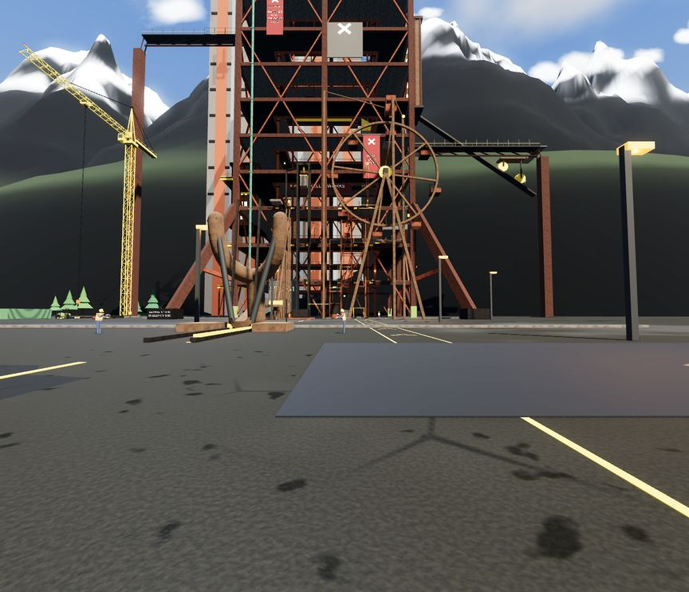
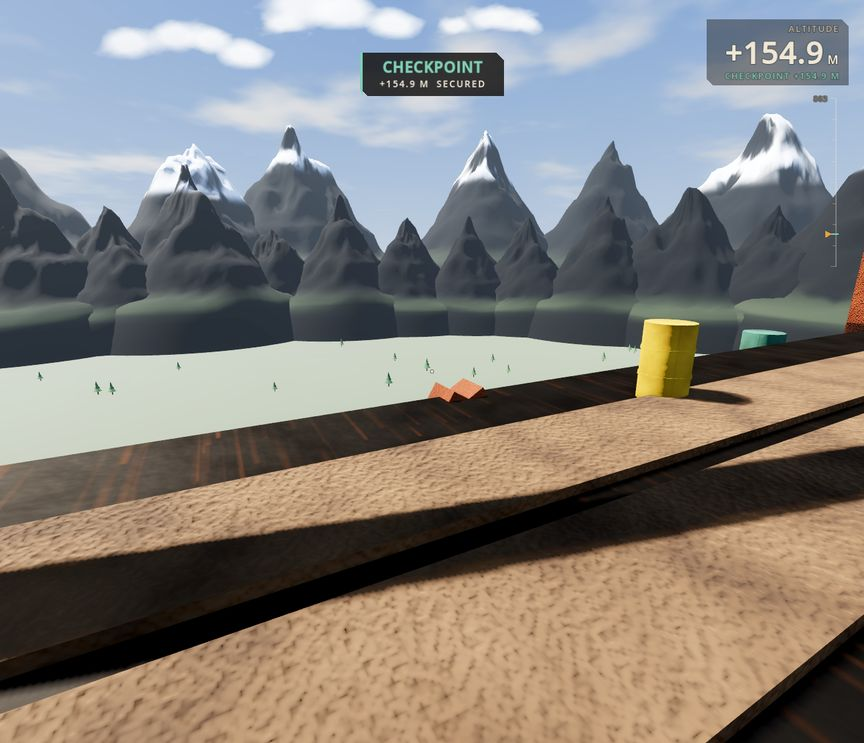
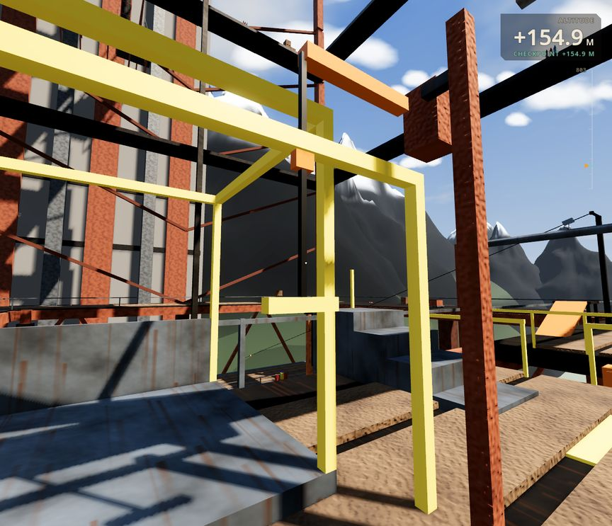
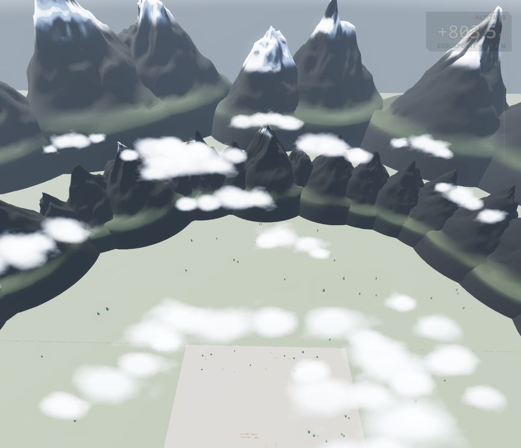
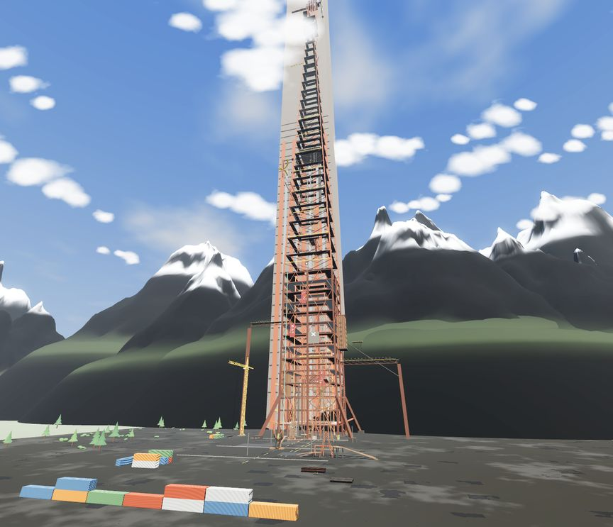
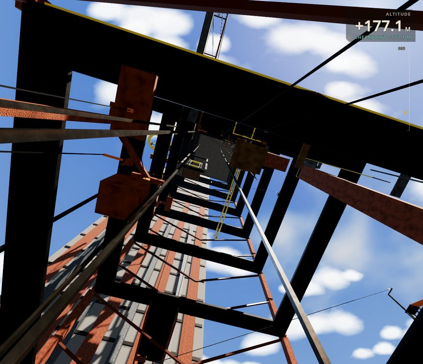
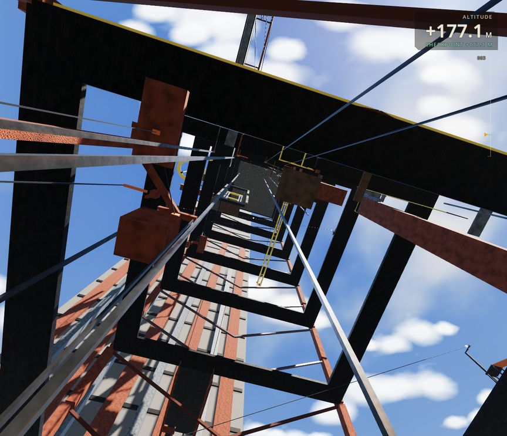
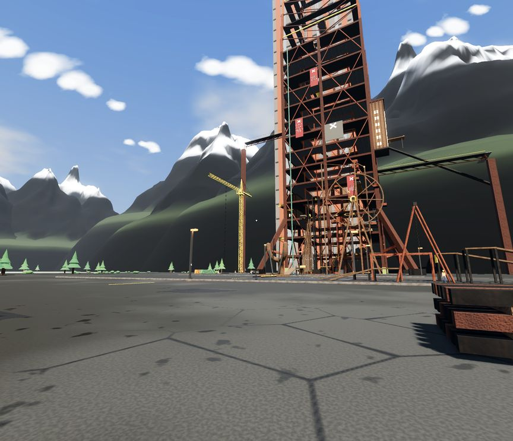
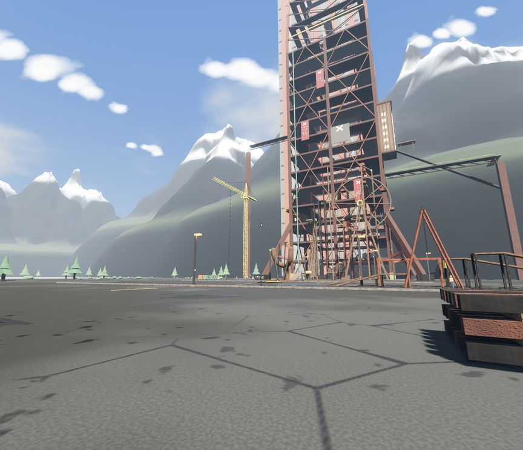
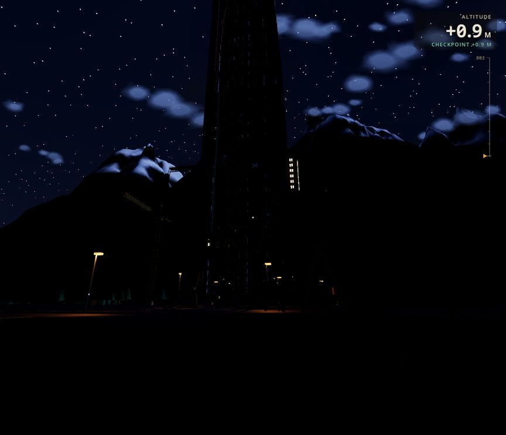
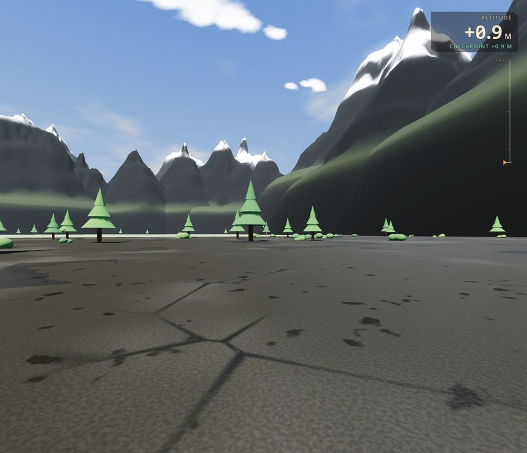
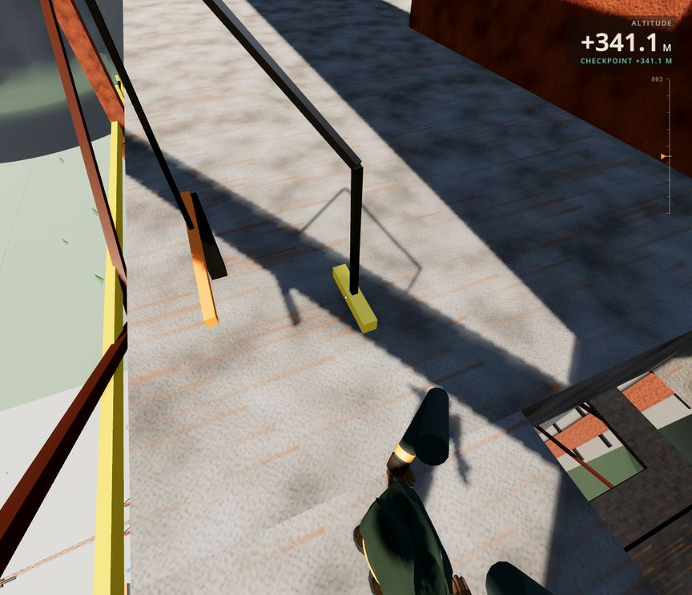
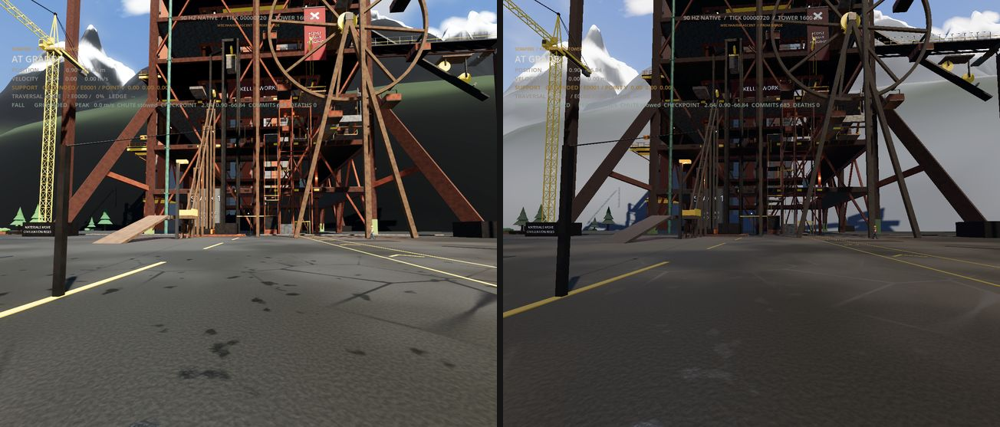
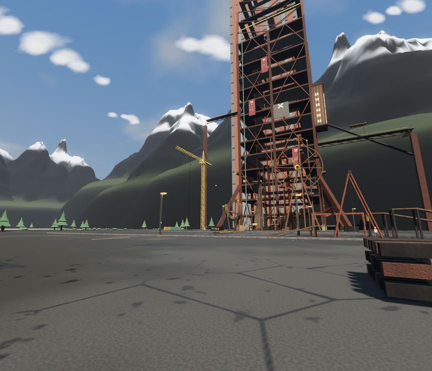

## Appendix A. The spots, and how to stand there

**Setting up a fresh worktree:**
1. Write `godot/.godot/extension_list.cfg` as CI does.
2. Copy `godot/addons/scraperx_native/bin/linux/libscraperx_native.so` from the main checkout.
   The native source must match.
3. Run `godot --headless --path godot --import` once.

**Launching:** `mcp__godot__run_project` with `projectPath` set to the worktree's `godot`, and
`background: true`. On llvmpipe a full-size screenshot needs a timeout of about 90 s.

**Setup script.** Run this once through `run_script`:

```gdscript
extends RefCounted
func execute(scene_tree: SceneTree) -> Variant:
	var main = scene_tree.root.get_node("TowerApproach")
	if main._consent_open:
		main._on_consent(false)
	main._close_title()
	var s = main._settings          # HIGH, his phone's default
	s.quality = 2; s.render_scale = 1.0; s.shadow_quality = 3; s.msaa = 1; s.bloom = true
	main._apply_settings()
	main._sky_cycle.day_minutes = 0.0
	main._sky_cycle.set_hour(10.5)  # or 17.2, 18.3 (DUSK), 23.5 (NIGHT)
	var cam := Camera3D.new()       # the free camera; the game's own camera is untouched
	cam.name = "AuditCam"; cam.fov = 82.0; cam.near = 0.05; cam.far = 2600.0
	main.add_child(cam)
	return "ready"
```

**Two kinds of spot:**
- **Eye spots.** Place the player with `main._native.debug_launch_player(P, Vector3.ZERO)`. Set
  `main._yaw` and `main._pitch`, and leave the game camera current.
- **Free spots.** Set `AuditCam` to position P, call `look_at(T, Vector3.UP)` and make it
  `current`.

Wait about 1.5 s after a placement.

| Spot | Kind | Player P | Camera |
|---|---|---|---|
| S1 yard start | eye | the start as launched, or (6.0, 1.0, -25.0) | yaw 0, pitch 0.05 |
| S2 yard wide | free | — | P (30, 1.7, 20), T (-60, 40, -150) |
| S3 154 m deck, out | eye | (-10.5, 155.0, -128.2) | yaw 0.85π, pitch -0.25 |
| S4 154 m deck, close | eye | same | yaw -0.6, pitch 0.1 |
| S5 221 m ring, out | eye | (4.0, 221.2, -129.2) | yaw π + 0.5, pitch -0.35 |
| S6 485 m ring, in the cloud layer | eye | (-3.0, 485.2, -139.6) | yaw 0.75π, pitch -0.1 |
| S7 summit deck | eye | (9.0, 803.65, -187.5) | yaw 0.9π, pitch -0.55 |
| S8 summit edge, down | free | — | P (9, 806, -120), T (20, 300, 400) |
| S9 shaft, up | free | (-7.6, 177.2, -131.2) | P (-7.6, 179, -131.2), T (-2, 260, -150) |
| S10 approach, 330 m out | free | — | P (70, 25, 160), T (-10, 180, -160) |
| S11 yard trees | free | — | P (-88, 1.7, -40), T (-160, 4, -80) |
| S12 TP-340 floor | free | (12, 341.2, -136.8) | P (12, 342.9, -136.8), T (-20, 300, -150) |

**The Mobile renderer (only if job 8 is in and the A/B is on):**
1. `apt-get update && apt-get install -y mesa-vulkan-drivers`.
2. Run CI's capture with `--rendering-method mobile`:
   `xvfb-run -a -s "-screen 0 1728x1485x24" <godot> --path godot --rendering-method mobile --quit-after 2400 -- --ci --capture=<png>`.
3. Check the log says "Forward Mobile". If it says "Compatibility", the driver is missing and the
   picture is not Mobile.

## Appendix B. For every brief: CLAUDE.md, "Test only what a change reaches"

Copied whole, as `CLAUDE.md` asks for every hand-off:

1. While fixing a failure, rerun only that test, and only its failing part where it lets you pick
   one (`SCRAPERX_ONLY=<group>`, `SCRAPERX_WAY=<n>`). Never edit a test to add a picker.
2. Once fixed, run once the native groups and touch scenarios the changed code can reach (which
   functions changed, which tests run them); say in the report which and why.
3. A test that passed on this exact code is not run again; nothing runs both in a scratch copy and
   in the tree being shipped.
4. The full native suite, every touch scenario and the Android build are CI's job, never also
   local. Before a push to `ScraperX-Claude`, run `wo000-delivery-spine.yml` once on
   `<agent>/integrate-<job>` (pushing it runs the proof) or dispatch it: that run is the proof (off
   trunk every job is green but `publish-checkpoint`, which stops with the expected KeyError at
   "Preserve Android updates"). The full native suite runs locally only when a change reaches the
   whole world (the kit's body order, the world's solids, shared physics or tuning, the contact
   listener, save layout) and no CI run is coming.
5. Read the PASS/FAIL lines and the lines around a failure, not whole logs.
6. Handing work to another agent: put this section in the brief.
